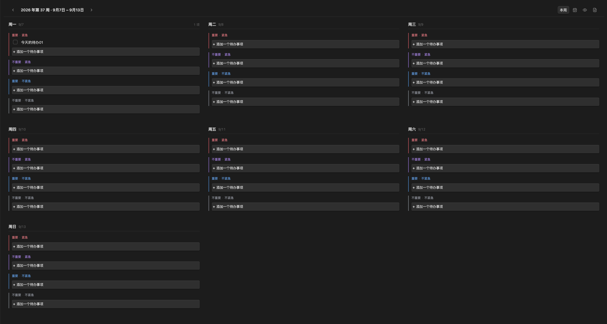
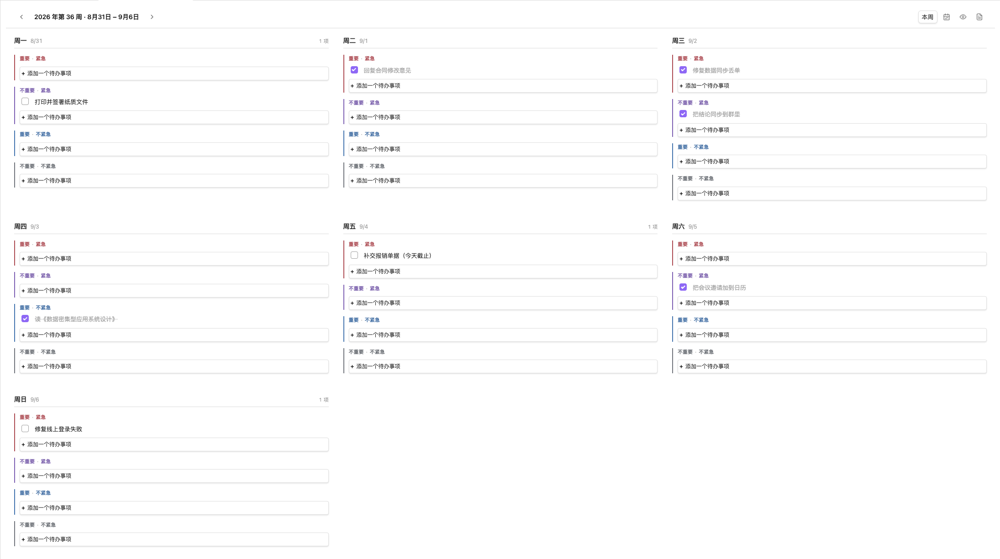
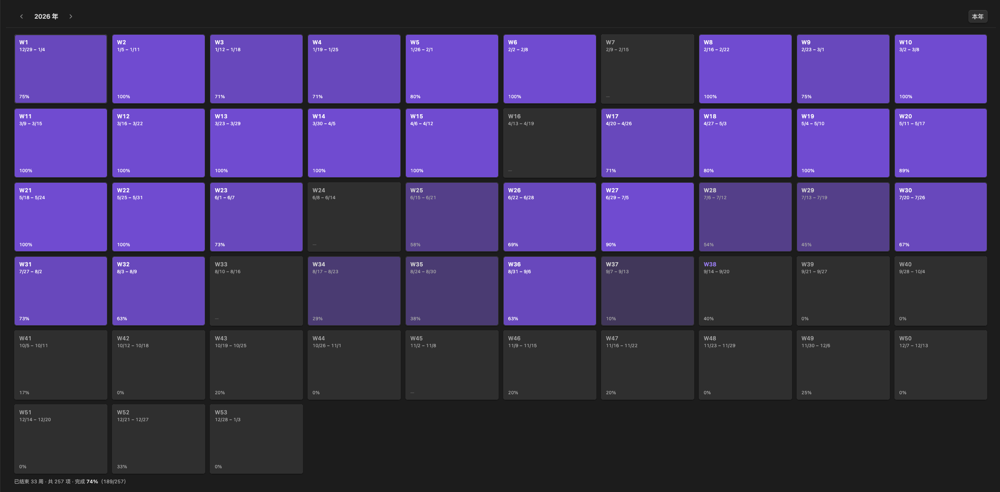
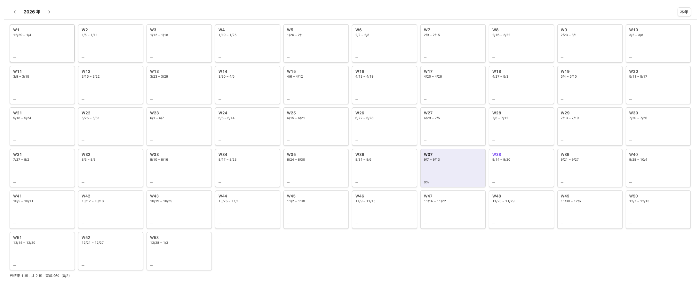

# Weekly Schedule

[English](README.md) · 简体中文

在 Obsidian 里规划并复盘你的一周。每周一块看板，每一天分成你自己命名、自己定数目的格子，整年可以一眼扫过去。



一天从四个格子开始 —— 重要 · 紧急、不重要 · 紧急、重要 · 不紧急、不重要 · 不紧急 —— 也可以完全按你的想法来：一到八个，名字自己起。空格子上有一个 **添加一个待办事项** 按钮，点它得到这一格的第一项，光标就在里面。一格里有待办之后按钮就不见了：往下一项的路，是在正在写的那一行末尾按 `Enter`，新的会出现在下一行。`Esc` 放弃这次编辑，留空的行不会写进文件。

一条待办可以写好几行，这时按 `Shift+Enter` 换行。这两个键哪个提交、哪个换行，由你在 **设置 → Weekly schedule** 里选；提交之后光标落到下一项，`Cmd`/`Ctrl`+`Enter` 则是提交并停下 —— 两种设置下都成立。

待办可以在格子之间、在天之间搬。把指针移到行上，行左侧会浮出一个把手，抓住它拖到任意一格：目标格子染上一层浅色，一条线告诉你它会把任务放在已有待办的哪两行之间。一行上只有把手能起拖 —— 文字区仍然归选字，行内的按钮仍然归点击。落回原处等于什么都没做；从上周带过来、末尾带标记的待办，标记会跟着走，因为标记说的是它从哪来，不是它现在在哪。拖动需要指针设备：触屏没有原生拖放，手机上仍然用剪切粘贴；也还没有撤销，想恢复就把它拖回去。

看板下方是本周的合计 —— **本周 12 项 · 已完成 5 · 完成 42%**，随敲随算，并且钉在面板底部，一周长到要滚动也不会把总结滚走。空的一周就直说「本周还没有待办」。

你所在的那一天，标题下有一条强调线，它会自己跟着日历走：看板或年视图开到半夜，它会把标记挪到新的一天，不用重载。

两个视图都跟随你的 Obsidian 主题；上面那张是深色，下面两张分别是浅色看板和深色年视图：

<details>
<summary>另一套主题下的两个视图</summary>





</details>

## 复盘一周

看板的第八格是这一周自己的复盘，和「天」一样画成一列，占掉第七天剩下的两格。它打开就是 PDCA 的四步 —— **计划（Plan）**、**执行（Do）**、**检查（Check）**、**改进（Act）**，每一步想写几条写几条：本来打算做什么、实际做成了什么、差距在哪、下周准备怎么改。

空着的一步，会把它要问的问题画成一行可以点的按钮，所以还没复盘的周是四个问题，而不是四个空框。一旦这一步有了一行，在这一行末尾按 `Enter` 就开出下一行，「添加」那一行同时消失 —— 和优先级格子是同一个形状。每一行都能用行内按钮或右键菜单上下移动、删除，但只在同一段内：四段是一个框架，不是一堆。

面板可以折起来，只剩标题；标题右侧带着本周的完成率，整条标题就是开关 —— 折起来之后，原本两格空白的位置只剩这一行。折叠只是换个看法，不是对内容做决定：两边都不写、也不丢。

复盘写在同一份文件里，排在所有天之后，有自己的标题：

```markdown
## 复盘

### 计划
- 把 0.7.0 发出去

### 执行
- 发了，但晚了两天
```

空着的段不写标题，四段全空时连 `## 复盘` 都不写 —— 没做复盘的周在文件里不留痕迹。复盘条目不是待办：不计入本周合计，也不会被带入下一周。

## 跳到任意一周

一周一周翻，翻一两周还行，翻到很远的地方就没什么用了。**打开年视图** 把整年铺开：每个 ISO 周一个格子，各自带周数、日期范围和完成率。点格子就打开那一周；`←` `→` `↑` `↓` 在格子间移动，`Enter` 打开。



填充的深浅就是完成率，一共六档。过完的周是填实的，还没到的周不填，没有待办的周显示一个破折号。年视图是一个独立面板，可以和看板并排一直开着。

## 从上周开始

上周很少干干净净地结束。**把上周未完成的工作带入本周** 一步收齐 —— 在命令面板里，或者看板工具栏上的箭头按钮。

它会先问。弹窗把上周所有未完成的项列出来，一行一项，各自标明会落到哪个星期、哪个优先级格子。默认全选，按钮跟着勾选数走，所以整周一次带走和临时去掉某一项一样容易。目标周已经有的项会标上 **已在本周**，而不是藏起来，也不会被加第二遍。

每一项都保留原来的星期和格子，所以这一周的形状跟着搬过去，而不是塌成一堆；也只有未完成的会搬。原来那一周一个字节都没少：这是复制，不是剪切，过去的一周仍然是当时计划的诚实记录。带过去的东西会在原文件里留一个标记，用那个文件自己的语言：

```markdown
- [ ] 修一下崩溃（已带入 2026-W40）
```

标记写的是它去了哪一周，而不是「下周」—— 隔几个月再读这个文件，没人知道「下周」是哪一周。比较和复制之前标记会先被剥掉，所以标记不会跟着溜进下一周，同一周确认两次也不会多出任何东西。搬完会有一条通知，说明带过来几项、几项本来就在。被带入的是屏幕上开着的那一周，所以先打开你要规划的那一周。

## 从昨天开始

一周是一周一周规划的，一天是一天一天过的。**把昨天未完成的待办带入今天** 是同一件事往下挪一天 —— 在命令面板里，或者今天那一列标题上、指针移上去才出现的箭头按钮。这件事只落在一个特定的日子上，所以按钮属于那一天的标题，而不属于工具栏。

它不问。一天的剩余是一张短清单，移动本身就是全部决定，所以这个直接做；每项保留原来的优先级格子。

它是移动而不是复制，这是和按周搬唯一的不同：昨天什么都不留，过去的一天只剩下还开着的事。今天已经有的说法不会被重复添加，通知会说明搬了几项、几项本来就在。

两天住在同一份周文件里，所以这件事只在这一周之内有效：星期一那天，昨天是上一周的星期日，这时候什么都不会发生，只有一条通知告诉你原因 —— 那种情况用按周搬。它移动的那一周，是今天所在的那一周，和看板正开着哪一周无关。

## 格子由你定

四个象限是一种分法，也是一种维护起来很贵的分法：判断一项工作属于四格里的哪一格，常常比这件事本身还费劲。所以格子归你。**设置 → Weekly schedule → 一天有哪几个格子** 按看板绘制的顺序列出它们，每个都有自己的名字输入框、一排颜色，以及上移、下移、删除、再添一个的按钮 —— 最多八个。

格子不是一个装着待办的容器，它是周文件里那一组待办上方的 `### ` 标题，它里面的工作属于那一周。正因如此，删掉一个是再平常不过的事：**什么都不会丢。** 被删的格子写过的标题会永久留在记录里，指向接管它工作的那个格子 —— 你给它起的名字，和它还没起名时插件写下的措辞，都留着 —— 所以去年写的周今天仍然读进对的格子。弹窗会问你要并到哪一个。

改名是同一套机制。已经写过的周保持原来的写法，照旧读得对，因为格子以前叫过什么也留着；变的只是**下一周**拿到的标题。把旧的对齐这件事，格子一改就会问你要不要做，之后也一直留在同一节的 **把它们对齐** 里。它会重写文件夹里每一周的格子标题 —— 待办、天、以及每周的复盘，一个字节都不动。

格子一改，所有开着的看板会立刻关掉（会有一条通知说明），下次打开的看板从文件重新读，按现在的格子来。这是为了不让一个留在屏幕上的面板继续显示、并且继续保存那份按已经不存在的格子读出来的工作。

每个格子穿八种颜色里的一种，颜色就在名字同一行上选，格子上下移动时颜色跟着走 —— 格子写的顺序和它穿的颜色是两件事。也可以从取色面板里挑一个调色板没有的色相：八种是看板解出来的数目，不是对你想法的限制。改颜色只是重画：没有标题变动，所以不关看板、也不重写文件。

八个格子比看板当初设计的要多，八格的一天也确实比四格高：两列的看板上、一天什么都不放时，一格量 93px，四格 290px，八格 551px。

## 文件怎么存

标准 Markdown 复选框，一周一个文件，按 ISO 年分文件夹：

```
weekly-schedule/
  2025/
    2025-W52.md
  2026/
    2026-W01.md
    2026-W12.md
```

```markdown
# 2026-W12

## 周一

### 重要 · 紧急
- [ ] 交周报
- [x] 修线上 bug
- [ ] 评审季度预算
  先看上个季度的偏差
  再确认明年的增长假设

### 不重要 · 不紧急
- [ ] 整理书签
```

每个 `### ` 标题是一天的其中一个格子，按那个格子的名字写 —— 所以同一周在英文库里是英文标题，而改过名的格子在两种语言下都写你自己的名字。没有待办的格子不写标题，文件保持短。因为它就是普通 Markdown，这些待办可搜索、能被别的任务插件读、能手改、能同步或进版本库。插件让文件和看板保持同步：在看板外面改文件会重新载入，看板里还没保存的编辑会赢过文件，而不是被丢掉。

写了好几行的待办，是复选框那一行加上后面每一行缩进两个空格 —— 就是它自己的纯文本，不加任何标记。空行会结束一条待办，文件和看板都一样，所以一条待办不能含空行：起新行的键连按两次只会留下一个换行，而不是一个下次读取时会被丢掉的空行。

文件夹用的是那一周的 **ISO 年**，不是日历年，所以 2025-12-29 那一周 —— 2026 年的第 1 周 —— 住在 `2026/` 里，和年视图的呈现一致。

英文库里同一周写成：

```markdown
# 2026-W12

## Monday

### Important · urgent
- [ ] Send the weekly report
- [x] Fix the production bug

### Unimportant · not urgent
- [ ] Tidy the bookmarks
```

### 早年直接写在根目录的文件

文件以前直接放在计划文件夹里（`weekly-schedule/2026-W12.md`）。插件仍然会从那里读，所以升级之后老库不会看起来空空如也。用 **把周文件移入年份文件夹** 命令（或设置里的按钮）把它们挪进去。只有计划文件夹里名字形如 `YYYY-Www.md` 的文件会被动，你放在那里的笔记不会被碰。

## 语言

插件按 Obsidian 的语言设置显示（**设置 → General → Language**），改了立刻跟着变 —— 不用重载，也没有需要配置的地方。

内置英文和简体中文。其他语言落到最接近的一个：`zh-TW` 落到简体中文，其余落到英文。

文件里被翻译的只有天标题，和「没人改过名的格子」的措辞 —— 你给格子起的名字在任何语言里都是那个名字，所以哪种语言下都写成一样。由此有一条规则：**文件保持它被写时的语言。** 切换 Obsidian 的语言会重新标注看板、年视图、命令和设置页，但绝不会重写你已有的文件 —— 切换之后打开一个旧的周，看到的是英文看板盖着中文文件。还没有文件的一周会按当前语言新建，所以一个库里两种语言可以共存，谁都不会读不出来：插件认识它发布过的每种语言的所有标题，翻译之前写的文件也照旧解析。

想转换一份已有文件，改它的标题就行 —— 这一周第一个被认出来的标题属于哪种语言，整份文件就按哪种语言写回去。

## 隐私

插件完全离线运行。不发任何网络请求，不收集任何遥测，只读写你自己库里、它自己的文件。

## 安装

进了社区目录之后，从 **设置 → 社区插件 → 浏览** 安装。

手动安装：从最新的 release 下载 `main.js`、`manifest.json` 和 `styles.css`，放进：

```
<库>/.obsidian/plugins/weekly-schedule/
```

然后在 **设置 → 社区插件** 里启用 **Weekly Schedule**。

需要 Obsidian **1.5.7** 或更高。

## 开发

开发环境、脚本、目录结构和发布流程都写在英文 README 里，见 [Development](README.md#development)。这一份只讲怎么用。
